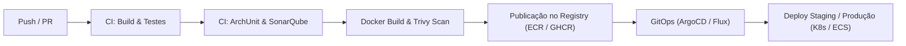

# Customer Product Activation Service

[](https://github.com/choliveira84/deroyque-it-consulting-services/actions/workflows/ci.yml)

Serviço de ativação de produtos de clientes desenvolvido em conformidade com o desafio técnico para **Java Developer Pleno/Sênior** da **Deroyque IT Consulting Services**.

A solução prioriza simplicidade, clareza e separação de responsabilidades (Arquitetura Hexagonal), tratando problemas reais de sistemas distribuídos: concorrência, idempotência, resiliência em integrações externas e tratamento padronizado de erros.

---

## 1. Como Executar e Testar

### 1.1 Pré-requisitos
- **Java 21** JDK instalado
- **Docker** e **Docker Compose** (para testes com banco real e execução dos contêineres)

---

### 1.2 Opção A: Subir o Ambiente Completo via Docker Compose (Recomendado)

O arquivo `docker-compose.yml` orquestra todos os serviços necessários para rodar e testar a solução de ponta a ponta:
- **`postgres`**: PostgreSQL 16 (porta `5432`).
- **`provider-mock`**: WireMock (porta `8089`) com stubs pré-configurados em `wiremock-stubs/mappings/` para simular o provedor externo com sucesso (`200 OK`).
- **`app`**: A aplicação Spring Boot construída via Dockerfile multi-stage (porta `8080`), com perfil `dev` ativo.

#### 1. Iniciar os contêineres
Na raiz do repositório, execute:
```bash
docker compose up -d --build
```

#### 2. Verificar o status dos contêineres
```bash
docker compose ps
```

#### 3. Verificar o Health Check da aplicação
```bash
curl http://localhost:8080/actuator/health
```
> **Resposta esperada:** `{"status":"UP","groups":["liveness","readiness"]}`

---

### 1.3 Opção B: Executar Localmente via Maven

Para rodar a aplicação diretamente no host (com o PostgreSQL rodando localmente na porta 5432):

```powershell
# No Windows PowerShell:
.\mvnw.cmd spring-boot:run -Dspring-boot.run.profiles=dev

# No Linux/macOS:
./mvnw spring-boot:run -Dspring-boot.run.profiles=dev
```

---

### 1.4 Como Executar os Testes Automatizados

O projeto conta com suíte de testes multi-camadas (unitários puros de domínio, concorrência com banco real via Testcontainers, mocks remotos com WireMock e regras arquiteturais com ArchUnit):

```powershell
# No Windows PowerShell:
.\mvnw.cmd clean verify

# No Linux/macOS:
./mvnw clean verify
```

---

### 1.5 Documentação Interativa (Swagger UI & OpenAPI 3.0)

A aplicação conta com documentação interativa OpenAPI 3.0 gerada automaticamente pelo SpringDoc:

- **Swagger UI (Navegador)**: [http://localhost:8080/swagger-ui.html](http://localhost:8080/swagger-ui.html)
- **Especificação OpenAPI JSON**: [http://localhost:8080/v3/api-docs](http://localhost:8080/v3/api-docs)
- **Especificação OpenAPI YAML**: [http://localhost:8080/v3/api-docs.yaml](http://localhost:8080/v3/api-docs.yaml)

#### Como Testar os Endpoints Diretamente pelo Swagger UI:
1. Acesse [http://localhost:8080/swagger-ui.html](http://localhost:8080/swagger-ui.html) no seu navegador.
2. Clique no botão verde **Authorize** (com ícone de cadeado) no canto superior direito.
3. No campo `bearerAuth`, informe o token de desenvolvimento:
   ```text
   dev-token
   ```
4. Clique em **Authorize** e feche o modal. O Swagger UI anexará automaticamente o cabeçalho `Authorization: Bearer dev-token` a todas as requisições disparadas pelo botão "Try it out".

---

### 1.6 Roteiro de Testes dos Endpoints da API

> **Autenticação no Perfil `dev`**: Para facilitar os testes locais sem exigir um servidor Keycloak/OAuth2 externo em execução, o perfil `dev` conta com um `devJwtDecoder` que aceita qualquer token Bearer (como `Bearer dev-token`) injetando automaticamente os escopos `SCOPE_activations:read` e `SCOPE_activations:write`.

#### 1. Criar Solicitação de Ativação (`POST /api/v1/requests`)
```bash
curl -i -X POST http://localhost:8080/api/v1/requests \
  -H "Authorization: Bearer dev-token" \
  -H "Content-Type: application/json" \
  -d '{
    "externalId": "EXT-10001",
    "customerId": "CUST-9901",
    "productCode": "INTERNET-500"
  }'
```

**Resposta esperada (`201 Created`):**
```http
HTTP/1.1 201 Created
Location: http://localhost:8080/api/v1/requests/d3b07384-d113-4ec6-8968-36a46dc49f50
X-Correlation-Id: a3f88921820...
Content-Type: application/json

{
  "id": "d3b07384-d113-4ec6-8968-36a46dc49f50",
  "externalId": "EXT-10001",
  "customerId": "CUST-9901",
  "productCode": "INTERNET-500",
  "status": "PENDING",
  "createdAt": "2026-10-28T18:50:00Z",
  "updatedAt": "2026-10-28T18:50:00Z"
}
```

> **Processamento Assíncrono**: O serviço grava o registro com status `PENDING` e o evento de outbox em menos de 10 ms. Em segundo plano, o `OutboxProcessorService` despacha para o provedor externo e atualiza o status para `COMPLETED`.

---

#### 2. Testar Idempotência (Mesmo `externalId`, Mesmo Payload)
Reenvie a mesma requisição com o mesmo `externalId` e dados idênticos:
```bash
curl -i -X POST http://localhost:8080/api/v1/requests \
  -H "Authorization: Bearer dev-token" \
  -H "Content-Type: application/json" \
  -d '{
    "externalId": "EXT-10001",
    "customerId": "CUST-9901",
    "productCode": "INTERNET-500"
  }'
```

**Resposta esperada (`200 OK` - Idempotente):**
Retorna `200 OK` com o registro existente, sem criar duplicidades no banco de dados.

---

#### 3. Testar Conflito (Mesmo `externalId`, Payload Divergente)
Envie o mesmo `externalId`, porém alterando o `productCode`:
```bash
curl -i -X POST http://localhost:8080/api/v1/requests \
  -H "Authorization: Bearer dev-token" \
  -H "Content-Type: application/json" \
  -d '{
    "externalId": "EXT-10001",
    "customerId": "CUST-9901",
    "productCode": "OUTRO-PRODUTO"
  }'
```

**Resposta esperada (`409 Conflict` - Problem Details RFC 9457):**
```json
{
  "type": "https://api.deroyque.com/problems/conflict",
  "title": "Request Conflict",
  "status": 409,
  "detail": "Conflict on activation with externalId 'EXT-10001': An activation request with this externalId already exists with divergent productCode or customerId",
  "instance": "/api/v1/requests",
  "traceId": "9f21b7..."
}
```

---

#### 4. Consultar Solicitação por ID (`GET /api/v1/requests/{id}`)
Substitua pelo UUID retornado na criação da solicitação:
```bash
curl -X GET http://localhost:8080/api/v1/requests/d3b07384-d113-4ec6-8968-36a46dc49f50 \
  -H "Authorization: Bearer dev-token"
```

**Resposta esperada (`200 OK`):**
```json
{
  "id": "d3b07384-d113-4ec6-8968-36a46dc49f50",
  "externalId": "EXT-10001",
  "customerId": "CUST-9901",
  "productCode": "INTERNET-500",
  "status": "COMPLETED",
  "createdAt": "2026-10-28T18:50:00Z",
  "updatedAt": "2026-10-28T18:50:02Z"
}
```

---

#### 5. Listar Solicitações com Paginação e Filtros (`GET /api/v1/requests`)
```bash
curl -X GET "http://localhost:8080/api/v1/requests?customerId=CUST-9901&status=COMPLETED&page=0&size=10" \
  -H "Authorization: Bearer dev-token"
```

---

#### 6. Encerrar os Serviços do Docker Compose
```bash
docker compose down
```

---

## 2. Decisões Técnicas

### 2.1 Estratégia contra Duplicidade e Concorrência (Item 3 do Desafio)
- **Garantia no Banco**: A verificação prévia no banco (`if (!exists)`) é insuficiente isoladamente devido à condição de corrida (TOCTOU). Criamos uma constraint única obrigatória (`uk_activation_requests_external_id`) no PostgreSQL.
- **Tratamento de Colisão Concorrente**: Se duas requisições com o mesmo `externalId` chegarem no mesmo milissegundo, uma é persistida com sucesso e a outra tem a exceção `DataIntegrityViolationException` capturada em sub-transação isolada (`REQUIRES_NEW`), recuperando a entidade existente e resolvendo o fluxo de forma segura sem corromper a sessão do Hibernate.
- **Semântica HTTP para Repetição**:
  - **Retry Legítimo (mesmo externalId, mesmo payload)**: Retorna `200 OK` com os dados do registro existente (ou `201 Created` na primeira requisição), garantindo idempotência total.
  - **Payload Conflitante (mesmo externalId, payload divergente)**: Retorna `409 Conflict` (Problem Details RFC 9457) explicitando que o `externalId` já está associado a outro cliente ou produto.
- **Bloqueio Otimista**: A entidade JPA utiliza a anotação `@Version` para blindar atualizações concorrentes de status.

#### 2.1.1 Estratégia de Indexação e Desempenho no PostgreSQL (Diferencial)
Para garantir alta performance e escalabilidade nas consultas paginadas e no processamento assíncrono, a migração Flyway cria índices B-Tree estrategicamente projetados:
1. **Índice Composto `idx_activation_requests_cust_status` em `(customer_id, status)`**:
   - **Regra de Seletividade e Cardinalidade**: A coluna com maior cardinalidade (`customer_id`, com milhares de valores distintos) precede a de baixa cardinalidade (`status`, com apenas 4 valores possíveis: `PENDING`, `PROCESSING`, `COMPLETED`, `FAILED`).
   - Isso permite que o PostgreSQL reduza imediatamente o espaço de busca para dezenas de tuplas antes de avaliar o status, executando um *Index Scan* de custo $O(\log N)$ em vez de um *Sequential Scan*.
   - **Prefix Matching**: Por estar na primeira posição do índice, pesquisas que filtram apenas por `customer_id` também utilizam esse mesmo índice, dispensando a sobrecarga de um índice redundante.
2. **Índice Simples `idx_activation_requests_created_at` em `(created_at DESC)`**:
   - **Prevenção de Filesort**: A listagem paginada padrão ordena por data decrescente. Sem esse índice, o banco realizaria um *Quicksort* em memória ou disco (*filesort*) sobre todo o resultado antes de aplicar o `LIMIT 20`. Com o índice, o PostgreSQL percorre o B-Tree e interrompe a leitura no 20º item.
3. **Índice da Tabela de Outbox `idx_outbox_status_next_retry` em `(status, next_retry_at)`**:
   - O worker de polling assíncrono consulta periodicamente eventos com `status IN ('PENDING', 'PROCESSING') AND next_retry_at <= NOW()`. Esse índice composto permite recuperar as mensagens pendentes instantaneamente, ignorando milhões de eventos `COMPLETED` históricos.

### 2.2 Desacoplamento Transacional e Integração Externa (Item 5 do Desafio)
- **Transactional Outbox Pattern**: Chamadas HTTP para `POST /provider/v1/activate` **nunca** ocorrem dentro de transações de banco de dados abertas. A solicitação de ativação e a mensagem de outbox são gravadas atomicamente em menos de 10 ms. O despacho ao provedor externo é executado de forma assíncrona desacoplada (`OutboxProcessorService`).
- **Resiliência e Idempotência no Provedor**:
  - Envio de cabeçalho `X-Idempotency-Key` único por tentativa para evitar ativações duplicadas em cenários de retry após timeout.
  - Timeouts explícitos configurados no `RestClient` (1s connect timeout, 3s read timeout).
  - Máquina de estados: `PENDING` → `PROCESSING` → `COMPLETED` / `FAILED`.

#### 2.2.1 Matriz de Comportamento por Retorno do Provedor (Diferencial)
Em conformidade com as diretrizes do desafio, o comportamento do serviço para cada resposta do provedor externo segue a matriz abaixo:

| Retorno do Provedor | Novo Status na API | Nova Tentativa? | Justificativa Técnica |
|---|---|---|---|
| **Sucesso (2xx)** | `COMPLETED` | Não | Ativação confirmada pelo parceiro externo com código de ativação. |
| **HTTP 400 (Bad Request)** | `FAILED` | Não | Erro de regra de negócio no parceiro (SKU inválido, dados incorretos). Tentar novamente geraria o mesmo erro e desperdiçaria recursos de rede/banco. |
| **HTTP 500 (Internal Server Error)** | Permanece `PROCESSING` | Sim (até 3x) | Falha transitória de infraestrutura no parceiro. Aplicamos retry com backoff exponencial e jitter aleatório. Ao esgotar 3 tentativas, transiciona para `FAILED`. |
| **Timeout (Conexão ou Leitura)** | Permanece `PROCESSING` | Sim (até 3x) | Falha na rede onde o resultado é ambíguo (o provedor pode ter processado ou não). Graças ao cabeçalho `X-Idempotency-Key`, a retransmissão é segura e idempotente. |
| **HTTP 429 / 503 com `Retry-After` (Diferencial)** | Permanece `PROCESSING` | Sim (respeitando header) | O parceiro está sob sobrecarga temporária (throttling) ou em janela de manutenção. Respeitamos o delay explícito do header `Retry-After` (em segundos ou data HTTP) acrescido de jitter (±10%) para evitar o **Thundering Herd Problem** (enxurrada sincronizada de clientes). |

- **Prevenção de Thundering Herd e Jitter**: Em cenários de retry, somamos uma variação aleatória de tempo (jitter) ao intervalo base para evitar que múltiplas solicitações bloqueadas tentem reconectar simultaneamente no mesmo milissegundo.

### 2.3 Tratamento de Erros e Segurança (Itens 6 e 7 do Desafio)
- **RFC 9457 (Problem Details)**: Todas as respostas de erro seguem o padrão `application/problem+json` suportado nativamente pelo Spring 6 (`ProblemDetail`), enriquecidas com `traceId` correlacionado via MDC. Nenhum stack trace ou detalhe interno é exposto ao consumidor.
- **Segurança (Spring Security como Resource Server)**:
  - Autenticação stateless baseada em tokens JWT (validando assinatura, emissor, audiência e expiração).
  - Autorização segregada por escopos: `SCOPE_activations:write` para `POST /api/v1/requests` e `SCOPE_activations:read` para consultas `GET`.
- **Proteção contra BOLA (Broken Object Level Authorization - OWASP Top 10 #1)**:
  - Em endpoints de consulta (`GET /api/v1/requests/{id}`), a aplicação valida se o `customerId` do registro pertence ao mesmo tenant identificado no token JWT (`sub` ou claim de organização), retornando `403 Forbidden` ou `404 Not Found` caso o cliente tente acessar dados de outros consumidores.
- **Proteção de Borda: Limites de Payload e Rate Limiting (Diferencial)**:
  - **Tamanho Máximo de Requisições**: Configurado no Spring Boot / Tomcat (`max-http-form-post-size: 1MB`, `max-request-size: 1MB`) para blindar o serviço contra ataques de negação de serviço por exaustão de memória heap (*Memory Exhaustion DoS*).
  - **Rate Limiting**: Arquitetura preparada para estrangulamento via algoritmo **Token Bucket** no API Gateway (Kong / AWS WAF / Spring Cloud Gateway) ou Bucket4j, estabelecendo cotas por cliente/IP (ex.: 100 requisições/minuto) com retorno `429 Too Many Requests`.

---

## 3. Cenário de Análise em Produção (Item 10 do Desafio)

> **Cenário**: Latência da API saltou de 300ms para 2,5s, banco de 50ms para 1,2s e provedor externo de 400ms para 3,0s, com CPU em 45% e Memória em 60%.

Uma análise aprofundada está documentada em [docs/production-incident-analysis.md](docs/production-incident-analysis.md). Em resumo:

- **Causa Raiz Comum**: **Esgotamento do pool de conexões (HikariCP Connection Pool Starvation)** causado por chamada HTTP remota dentro de transação de banco de dados ativa (`@Transactional`). Quando o provedor passou a demorar 3s, cada requisição prendeu uma conexão do banco durante todo o tempo de rede. Com as conexões ocupadas, todas as demais queries (mesmo simples leituras) ficaram bloqueadas na fila, elevando artificialmente o tempo percebido das queries para 1,2s e da API para 2,5s, enquanto CPU e memória permaneceram ociosas.
- **Investigação**: Verificar métricas de `hikaricp.connections.pending` e `hikaricp.connections.acquire.time`, thread dump identificando threads bloqueadas e `pg_stat_activity` com estado `"idle in transaction"`.
- **Solução Definitiva**: Adoção do padrão **Transactional Outbox**, liberando a transação de banco antes de iniciar a comunicação com o provedor.

---

## 4. Operação em Produção e Cloud

### 4.1 Pipeline de CI/CD (Diferencial)

O projeto conta com automação de **CI (Continuous Integration)** via **GitHub Actions** (`.github/workflows/ci.yml`), garantindo que nenhum código seja integrado à branch principal sem passar pelos quality gates.

#### 1. Pipeline de CI no Repositório (Implementado)
A cada `push` ou `pull_request` para a branch `main` ou branches de feature:
1. **Ambiente Isolado**: Runner `ubuntu-latest` com Docker daemon disponível para Testcontainers.
2. **Ambiente Java**: Setup do Eclipse Temurin JDK 21 com cache automatizado de dependências Maven (`~/.m2/repository`).
3. **Quality Gates & Testes (`./mvnw clean verify`)**:
   - Compilação estrita em Java 21.
   - Execução de testes unitários puros de domínio.
   - Verificação de conformidade arquitetural com **ArchUnit** (blindando o isolamento do core hexagonal).
   - Testes de integração de concorrência com PostgreSQL real via **Testcontainers**.
   - Testes de integração de resiliência e contratos de provedor via **WireMock**.
   - Testes de documentação e rotas públicas do **OpenAPI / Swagger UI**.
4. **Smoke Test de Contêiner**: Execução de `docker build` validando a integridade do `Dockerfile` multi-stage.
5. **Otimização de Concorrência**: Cancelamento automático de builds anteriores obsoletos (`cancel-in-progress: true`) quando novos commits são enviados rapidamente.

#### 2. Roadmap do Pipeline Completo até o Deploy em Produção (Visão Cloud)
Para um ambiente empresarial de produção em nuvem, o fluxo estende-se para uma esteira de **CD (Continuous Deployment)**:

1. **Build e Testes (CI)**: Execução de testes unitários, testes de mutação, validação de regras de arquitetura e análise estática de qualidade/segurança (SonarQube e SAST).
2. **Container Packaging e Vulnerability Scan**: Construção da imagem Docker multi-stage, execução de scan de vulnerabilidades de pacotes e SO (Trivy / Snyk) e assinatura digital da imagem via **Cosign**.
3. **Publicação no Container Registry**: Envio da imagem para registry seguro (AWS ECR, Google Artifact Registry ou GHCR) versionada por Semantic Versioning (`v1.2.3`) e SHA imutável do commit.
4. **Deploy Automatizado via GitOps**:
   - Um repositório de infraestrutura/manifestos (Kustomize ou Helm) é atualizado com a nova tag da imagem.
   - O **ArgoCD** ou **Flux** detecta a alteração e sincroniza o cluster Kubernetes (EKS / GKE) ou cluster AWS ECS.
   - Aplicação de estratégia **Canary Release** ou **Blue/Green** com análise de métricas (Prometheus / Datadog) e rollback automatizado em caso de aumento na taxa de erros (HTTP 5xx) ou latência p99.

### 4.2 Arquitetura de Execução e Resiliência em Cloud

- **Dockerfile Multi-Stage**: Imagem baseada em Alpine Linux, utilizando JRE Temurin 21 enxuta, usuário não-root (`appuser`), flags JVM ajustadas para contêineres (`-XX:MaxRAMPercentage=75.0 -XX:+UseG1GC`) e probe de health check integrado.
- **Execução em Múltiplas Instâncias**:
  - Graças à constraint única no banco relacional e ao locking otimista, múltiplas instâncias da API podem rodar em paralelo atrás de um Load Balancer (Kubernetes Ingress / AWS ALB) sem risco de duplicidade de ativações.
  - Para o processamento do Outbox em múltiplas instâncias, utiliza-se skip-locked (`SELECT ... FOR UPDATE SKIP LOCKED`) ou agendador distribuído (ShedLock).
- **Segredos e Configurações**: Variáveis de ambiente injetadas via Kubernetes Secrets, AWS Secrets Manager ou HashiCorp Vault.
- **Comunicação Orientada a Eventos**: Publicação de eventos em tópicos Kafka ou RabbitMQ para notificar outros microsserviços após a transição para `COMPLETED`.

---

## 5. Pontos Pendentes e Melhorias Futuras

1. **Broker de Mensagens Distribuído**: Evoluir o worker de outbox baseado em banco para publicação direta no Apache Kafka com Debezium (CDC) para altíssima escala.
2. **Circuit Breaker com Resilience4j**: Interromper chamadas imediatas ao provedor quando a taxa de falhas exceder o limiar de tolerância.
3. **OpenTelemetry Tracing**: Exportar spans distribuídos para Jaeger / Tempo / Datadog.

---

## 6. Uso de Ferramentas de IA

Em conformidade com a recomendação do desafio, este projeto utilizou o **GitHub Spec Kit** com assistência do agente de IA **Antigravity** (Google DeepMind) nas seguintes etapas:
- Estruturação do repositório e geração dos artefatos do fluxo Spec Kit (`constitution.md`, `spec.md`, `plan.md`, `tasks.md`).
- Elaboração do plano de testes multi-camadas (Testcontainers, WireMock, ArchUnit).
- Escrita e documentação das decisões arquiteturais (ADRs).
