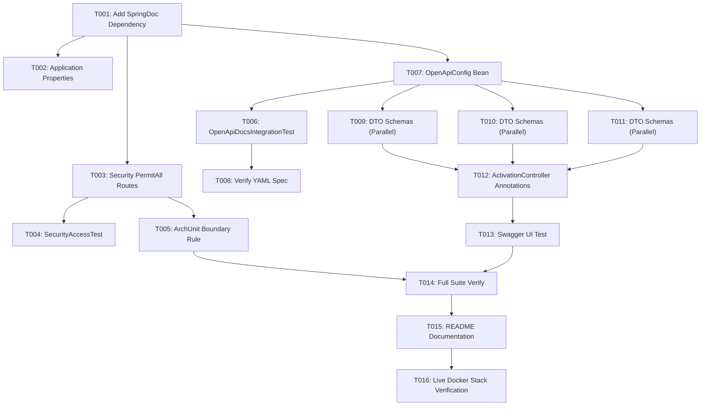

# Tasks: OpenAPI and Swagger UI Documentation

**Input**: Design documents from `/specs/002-openapi-swagger/`  
**Prerequisites**: `plan.md`, `spec.md`, `research.md`, `contracts/openapi.yaml`, `quickstart.md`  

---

## Phase 1: Setup (Dependency & Configuration)

**Purpose**: Add SpringDoc OpenAPI starter and baseline configuration

- [X] T001 Add `springdoc-openapi-starter-webmvc-ui` dependency (version `2.6.0`) to `pom.xml`
- [X] T002 [P] Configure SpringDoc properties (API docs path, Swagger UI path, disable actuator clutter) in `src/main/resources/application.yml`

---

## Phase 2: Foundational (Security Exemption & Architectural Guardrails)

**Purpose**: Configure public security access for documentation endpoints and enforce architecture boundaries

- [X] T003 Update `SecurityConfig.java` in `src/main/java/com/deroyque/activation/infrastructure/security/SecurityConfig.java` to permit unauthenticated public access (`permitAll`) for `/v3/api-docs/**`, `/swagger-ui/**`, and `/swagger-ui.html`
- [X] T004 Update `SecurityAccessTest.java` in `src/test/java/com/deroyque/activation/web/SecurityAccessTest.java` to verify unauthenticated `GET /v3/api-docs` and `GET /swagger-ui/index.html` return HTTP 200 OK while API routes still return HTTP 401 Unauthorized
- [X] T005 Add ArchUnit assertion in `ArchitectureRulesTest.java` under `src/test/java/com/deroyque/activation/architecture/ArchitectureRulesTest.java` verifying domain and application packages have zero dependencies on `io.swagger` or `org.springdoc`

**Checkpoint**: Foundation ready - documentation routes are publicly accessible in security filters, and architectural boundaries are guarded by ArchUnit.

---

## Phase 3: OpenAPI Spec Bean & Security Scheme (US2 & US3)

**Goal**: Expose machine-readable OpenAPI 3.0 specification (`/v3/api-docs`) with JWT Bearer Authentication scheme (`bearerAuth`)

**Independent Test**: Request `GET /v3/api-docs` and verify HTTP 200 OK with valid JSON schema containing info metadata and `bearerAuth` security scheme.

### Tests
- [X] T006 Create integration test `OpenApiDocsIntegrationTest.java` in `src/test/java/com/deroyque/activation/web/OpenApiDocsIntegrationTest.java` asserting `GET /v3/api-docs` returns 200 OK with JSON content type and valid OpenAPI elements

### Implementation
- [X] T007 [US3] Create `OpenApiConfig.java` in `src/main/java/com/deroyque/activation/infrastructure/configuration/OpenApiConfig.java` configuring `OpenAPI` bean with title "Deroyque Product Activation Service API", version "1.0.0", description, contact, and global `bearerAuth` HTTP Bearer JWT SecurityScheme
- [X] T008 [US2] Verify machine-readable YAML specification is also accessible at `/v3/api-docs.yaml`

**Checkpoint**: OpenAPI 3.0 specification endpoint is fully operational and authenticated schemes are registered.

---

## Phase 4: User Story 1 - Rich Swagger Documentation for Activation Controller & DTOs (US1)

**Goal**: Provide rich, interactive documentation on Swagger UI (`/swagger-ui.html`) with operation descriptions, parameters, status codes, and realistic example payloads.

**Independent Test**: Navigate to `http://localhost:8080/swagger-ui/index.html` in browser or MockMvc; verify HTML loads and API tag "Activation Requests" lists all 3 endpoints with request/response schemas.

### Implementation
- [X] T009 [P] [US1] Annotate `CreateActivationRequestDto.java` in `src/main/java/com/deroyque/activation/infrastructure/web/dto/CreateActivationRequestDto.java` with `@Schema` descriptions and realistic examples
- [X] T010 [P] [US1] Annotate `ActivationResponseDto.java` in `src/main/java/com/deroyque/activation/infrastructure/web/dto/ActivationResponseDto.java` with `@Schema` property descriptions
- [X] T011 [P] [US1] Annotate `PaginatedResponseDto.java` in `src/main/java/com/deroyque/activation/infrastructure/web/dto/PaginatedResponseDto.java` with `@Schema` descriptions
- [X] T012 [US1] Annotate `ActivationController.java` in `src/main/java/com/deroyque/activation/infrastructure/web/ActivationController.java` with `@Tag(name = "Activation Requests")`, `@Operation`, and `@ApiResponses`:
  - `POST /api/v1/requests`: Document 201 Created (with `Location` and `X-Correlation-Id`), 200 OK (idempotent replay), 400 Bad Request, 401 Unauthorized, 409 Conflict
  - `GET /api/v1/requests/{id}`: Document 200 OK, 401 Unauthorized, 404 Not Found
  - `GET /api/v1/requests`: Document query parameters, 200 OK, 401 Unauthorized
- [X] T013 [US1] Add test case in `OpenApiDocsIntegrationTest.java` verifying `/swagger-ui/index.html` responds with 200 OK and contains Swagger UI HTML bundles

**Checkpoint**: Swagger UI is fully interactive, comprehensive, and ready for end-user execution.

---

## Phase 5: Polish & Verification

**Purpose**: Cross-cutting verification, documentation updates, and Docker runtime validation

- [X] T014 Execute full automated test suite `./mvnw clean verify` ensuring all tests pass cleanly with zero warnings
- [X] T015 Update `README.md` to document the Swagger UI URL (`http://localhost:8080/swagger-ui.html`), how to authorize using `dev-token`, and how to fetch OpenAPI specifications
- [X] T016 Rebuild and restart the Docker container stack (`docker compose up -d --build app`) and execute cURL to confirm Swagger UI and OpenAPI endpoints respond successfully live in Docker

---

## Dependencies & Execution Order

---

## Implementation Strategy

1. **Phase 1 & 2 (Setup & Security Guardrails)**: Add dependency, permit routes in security filter, and establish ArchUnit tests.
2. **Phase 3 (OpenAPI Spec & Security Scheme)**: Create `OpenApiConfig`, wire `bearerAuth` JWT scheme, and verify JSON/YAML endpoints.
3. **Phase 4 (Interactive UI & Controller Enrichment)**: Document controller operations and DTO schemas with examples.
4. **Phase 5 (Polish & Docker Verification)**: Run full test suite, update documentation, rebuild Docker, and test live.
